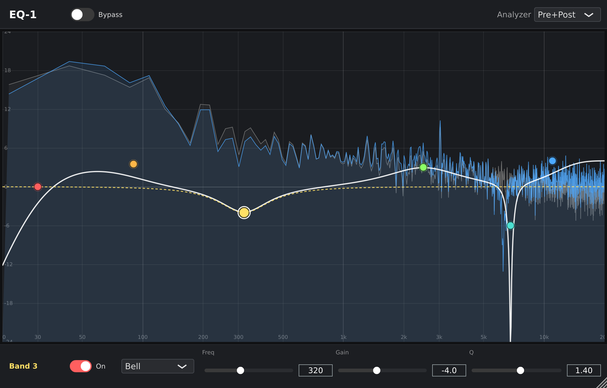
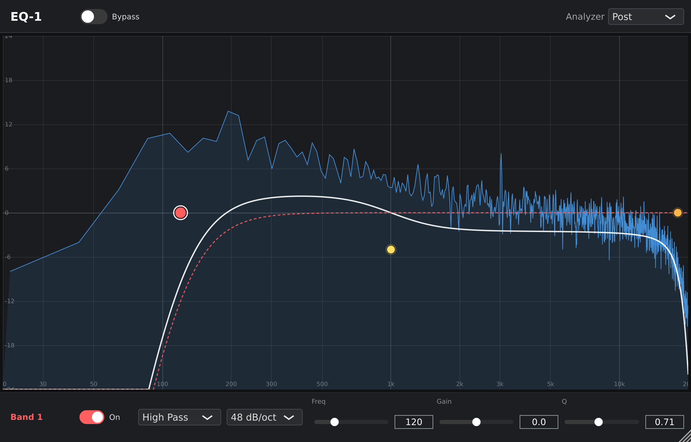

# EQ-1

JUCEで作った、グラフを直接操作するタイプのパラメトリックEQプラグインです(VST3 / AU / Standalone)。
FabFilter Pro-Q 3のような操作感を目標に、最大16バンドを周波数グラフ上で追加・ドラッグして音作りできます。



## 機能

- **最大16バンドの可変バンドEQ** — グラフ上の空いている場所をクリックするとバンドを追加
- **8種類のフィルタ** — Bell / Low Shelf / High Shelf / Low Pass / High Pass / Notch / Band Pass / Tilt Shelf
- **Low Pass / High Passのスロープ切替** — 6 / 12 / 18 / 24 / 36 / 48 dB/oct(2次IIRを最大4段カスケード)
- **リアルタイム・スペクトラムアナライザー** — EQ前(Pre)・EQ後(Post)・両方を重ねて表示を切替可能
- **合成カーブと個別カーブの表示** — 全バンドを合成した周波数特性に加え、選択中バンド単体の特性を破線で表示
- **パラメータスムージング** — Freq / Gain / Qの変化を補間し、操作中のジッパーノイズを抑制
- **リサイズ可能なフラットUI** — 画像アセットを使わず、すべてベクター描画



*48 dB/octのHigh Pass、Tilt Shelf、Low Passを組み合わせた例(アナライザーはPost表示)*

## 操作方法

| 操作 | 動作 |
| --- | --- |
| 空いている場所をクリック | バンドを追加 |
| ノードをクリック | バンドを選択 |
| ノードをドラッグ | Freq(横)・Gain(縦)を変更 |
| ノード上でマウスホイール | Qを変更 |
| ノードを右クリック | フィルタ種別・スロープを変更 |
| ノードをダブルクリック / Deleteキー | バンドを削除 |

画面下部のコントロールストリップでは、選択中バンドのOn/Off・種別・スロープ・Freq・Gain・Qを数値で編集できます。

## 構成

```
Source/
├── PluginProcessor.*        オーディオ処理本体、APVTSのパラメータ定義
├── PluginEditor.*           エディタ(TopBar / グラフ / コントロールストリップの3段構成)
├── DSP/
│   ├── FilterBand.*         フィルタ種別ごとのIIR係数計算(オーディオ・UI両スレッドから共用)
│   └── SpectrumAnalyzer.*   ロックフリーFIFO + FFTによるスペクトラム解析
└── GUI/
    ├── EQGraphComponent.*   メインのインタラクティブなEQグラフ
    ├── BandControlStrip.*   選択中バンドの数値編集
    ├── TopBarComponent.*    マスターバイパス・アナライザー切替
    └── FlatLookAndFeel.*    フラット/ダークテーマのLookAndFeel
```

### 設計のポイント

- **可変バンド数とAPVTS** — `AudioProcessorValueTreeState`は実行時にパラメータ数を変えられないため、
  16バンド分のパラメータ(`band{n}_enabled / freq / gain / q / type / slope`)をあらかじめ確保し、
  `enabled`フラグでバンドの追加・削除を表現しています。DAWのオートメーションもすべてのバンドで有効です。
- **係数計算の共通化** — `eq::computeBandCoefficients()`はフィルタ実体を持たない純粋関数で、
  オーディオスレッドのフィルタ更新とUIスレッドの周波数特性描画の両方から同じ計算を使います。
- **スレッド間の受け渡し** — アナライザーは`juce::AbstractFifo`でオーディオスレッドから
  UIスレッドへサンプルを渡し、オーディオスレッド側ではメモリ確保もロックも行いません。

## ビルド

[JUCE](https://github.com/juce-framework/JUCE)(9.x)とCMake 3.22以上が必要です。
`CMakeLists.txt`は1つ上の階層にあるJUCEを参照するので、次のように配置してください。

```
plugins/
├── JUCE/     ← git clone https://github.com/juce-framework/JUCE.git
└── EQ-1/     ← このリポジトリ
```

```bash
cmake -B build -DCMAKE_BUILD_TYPE=Release
cmake --build build -j$(nproc)
```

ビルド成果物は`build/EQ1_artefacts/Release/`以下(`VST3/`、`Standalone/`、macOSでは`AU/`)に出力されます。

```bash
# スタンドアロン版の起動
./build/EQ1_artefacts/Release/Standalone/EQ-1
```
